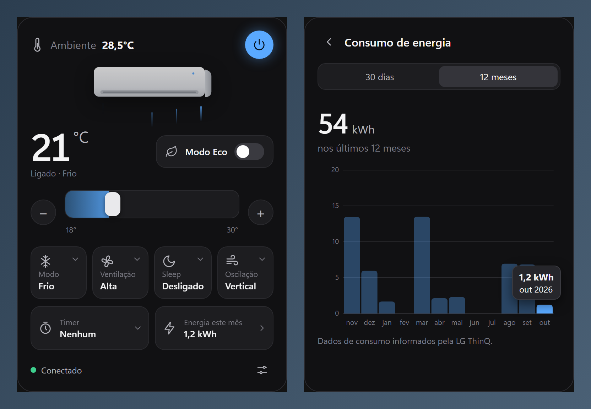

# LG AC Tray

Control your **LG ThinQ** air conditioner straight from the Windows system tray, no phone needed.



The tray icon shows the temperature, with a blue background while the AC is on. Click it to open the popup. Click outside it or press `Esc` to close.

> The app interface is currently in Brazilian Portuguese.

## Features

- Power on / off
- Target temperature slider plus `−` `+` buttons (range and step come from the device itself)
- Room temperature
- Mode (Cool, Auto, Fan, Dry… depending on the model)
- Fan speed (Low, Medium, High, Auto, Natural)
- Eco mode
- Sleep timer (turn off in 30 min – 8 h)
- Timer to turn on or off
- Vertical swing, plus horizontal swing if the model supports it
- Energy usage: current month total and charts for the last 30 days and 12 months
- Filter usage
- Launch at Windows startup
- Auto-refresh every 30 s and whenever the popup opens

The available options are built from the **device profile** returned by the API, so models with more or fewer features are shown correctly.

## Installation

1. Download the `LG AC Tray_x.y.z_x64-setup.exe` installer from [Releases](../../releases) and run it, or build it yourself (see below).
2. Create an LG **Personal Access Token**:
   - Go to **https://connect-pat.lgthinq.com** and sign in with the same account you use in the LG ThinQ app.
   - Click **ADD NEW TOKEN**, select all device permissions, and create it.
   - Copy the token (`thinqpat_…`).
3. Open LG AC Tray. On first launch it shows the settings screen. Paste the token, enter your account's country code (e.g. `BR`, `US`), and click **Salvar e conectar** (Save and connect).

> Tip: to keep the icon always visible, go to **Windows Settings › Personalization › Taskbar › Other system tray icons** and turn on LG AC Tray.

The token is stored only on your computer, in `%APPDATA%\com.aircond.tray\config.json`. It is sent only to LG's API.

## Building from source

Prerequisites (Windows):

- [Node.js](https://nodejs.org/) 18+
- [Rust](https://rustup.rs/) (`stable-x86_64-pc-windows-msvc` toolchain)
- [Visual Studio Build Tools](https://visualstudio.microsoft.com/visual-cpp-build-tools/) with the **Desktop development with C++** workload
- WebView2 (preinstalled on Windows 11)

```powershell
npm install
npm run dev     # run in development mode
npm run build   # produces src-tauri/target/release/bundle/nsis/LG AC Tray_x.y.z_x64-setup.exe
```

To change the app icon, replace `assets/icon.png` (1024×1024) and run `npm run icons`.

### Previewing the UI without the app

Open `ui/index.html` directly in a browser. Without the Tauri bridge, the UI runs on sample data and makes no calls to LG, which is handy for tweaking the visuals.

## Project structure

```
ui/                 Popup UI (plain HTML, CSS and JS, no bundler)
  index.html
  style.css
  app.js            State → view, commands, menus, energy chart, tray icon
src-tauri/
  src/main.rs       Tray, popup positioning, config and Tauri commands
  src/thinq.rs      LG ThinQ Connect API client
  tauri.conf.json
assets/icon.png     App icon source
docs/               README images
```

## How it works

The app uses the **official LG ThinQ Connect API** with a Personal Access Token. It calls these endpoints:

| Endpoint | Purpose |
|---|---|
| `GET /devices` | Finds the air conditioner on the account |
| `GET /devices/{id}/profile` | Supported features (modes, temperature ranges…) |
| `GET /devices/{id}/state` | Current state |
| `POST /devices/{id}/control` | Sends commands |
| `GET /devices/energy/{id}/profile` | Checks whether the device reports energy usage |
| `GET /devices/energy/{id}/usage` | Daily / monthly energy usage |

The server is picked from the account's country: `api-aic` for the Americas, `api-eic` for Europe and `api-kic` for Asia/Oceania.

The `x-api-key` value in `src-tauri/src/thinq.rs` is the **public** key shipped with LG's official [`thinqconnect`](https://pypi.org/project/thinqconnect/) SDK. It is not a secret. Your account is identified by your token, which never lives in the code.

The tray icon is drawn on a `<canvas>` in the front end (the temperature as text) and passed to Rust as RGBA.

## Limitations

- State is refreshed by polling every 30 s. The API offers real-time MQTT notifications, which are not implemented yet.
- Energy usage is shown in kWh, assuming the API returns Wh.
- Tested only on Windows 11 with an LG Dual Inverter split unit.

## Disclaimer

Personal project, not affiliated with LG Electronics. "LG" and "ThinQ" are trademarks of LG Electronics.
